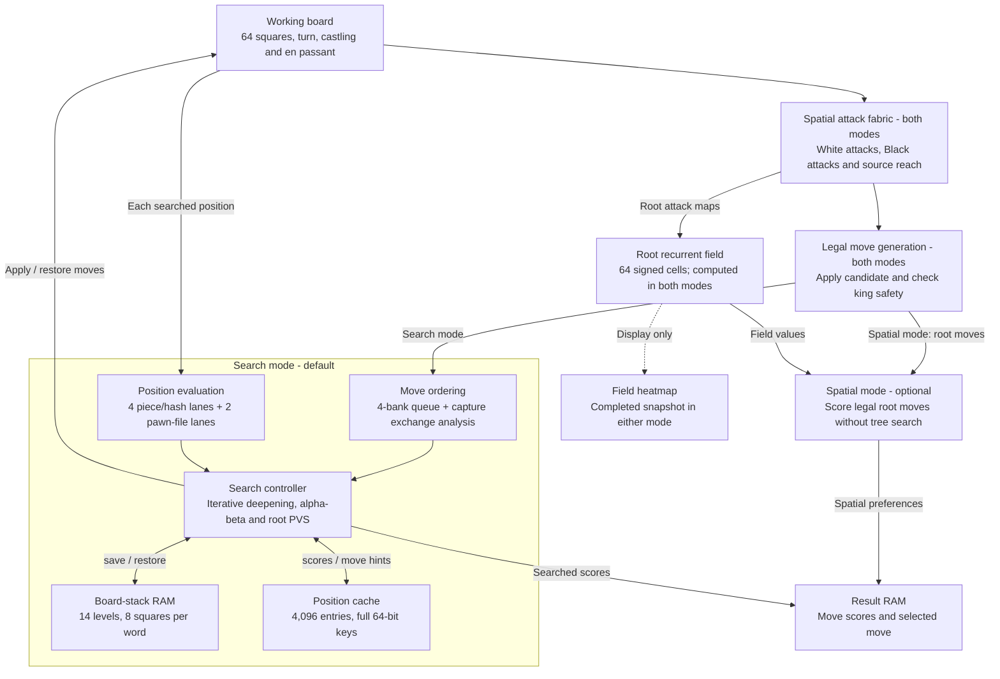

# FPGA Chess Engine — DE0-CV + Raspberry Pi SPI

The FPGA generates and verifies legal moves, runs the recurrent spatial field,
and chooses moves with iterative alpha-beta search up to **eight plies**.
The advanced engine retains four evaluation/hash lanes, four move-queue banks,
the 4,096-entry position cache, root PVS, capture exchange analysis, quiescence,
positional evaluation, completed-iteration deadlines and protocol-5 telemetry.
The default is five plies with a ten-second budget. The Raspberry Pi hosts the
web board; the browser independently checks hardware moves and board readback.

This port uses the DE0-CV's native **50 MHz** clock, with the controller enabled
every four clocks. SPI, RAM and the engine share this clock domain. Pawn-file
evaluation uses one lane to save duplicated arithmetic.


## Features

- Raspberry Pi Zero 2 W or many other Microcontrolers, can host or connect to a wifi network and play chess against the FPGA
- Play White or Black against the FPGA, watch it play both sides, or play locally
  with another person.
- Set search depth from 2 to 8 plies and choose a time limit. Defaults are
  5 plies and 10 seconds per move.
- Castling, en passant, all four promotion choices, undo and PGN export.
- View the searched line, move scores, completed depth, node count and time spent
  in each engine phase. The field heatmap is available in either mode.
- Speed round gives the human a clock; on expiry, the FPGA makes a Spatial move
  for that side.

## Engine architecture

The spatial attack fabric is shared by both decision modes. In the default
Search mode, the controller repeatedly uses it on the working board as it
explores moves and replies. In Spatial mode, the same legality checks feed a
root move scorer driven by the recurrent field.

One controller walks the search tree, saving and restoring one working board.
The attack network evaluates all 64 squares concurrently; evaluation lanes and
banked RAM speed up work within each searched position.



### Spatial attack fabric

Here, "spatial" means that the circuit's connections follow chessboard
geometry. Every square has logic connected to other squares according to the
pieces' movement rules. Changing the working board changes the attack maps
through those wires, so the controller can use them at every search node.

For rooks, bishops and queens, each square receives rays from the appropriate
neighboring squares. An empty square passes a ray onward; an occupied square
stops it. A rook on a1 with a blocker on a3 therefore attacks a2 and a3, but
does not reach a4 through a8 along that file. Knights use fixed L-shaped
connections, kings use adjacent-square connections, and pawns use diagonal
attack connections.

Three copies of this geometry run concurrently:

- **White attacks:** squares attacked by any White piece.
- **Black attacks:** squares attacked by any Black piece.
- **Selected-source reach:** destinations reached by the one piece the move
  generator is currently considering.

These maps describe attacks and reach, not the complete set of legal moves.
The controller filters friendly occupied destinations and adds pawn pushes,
double pushes and castling. It applies each candidate, handles promotion or
en passant, and reads the resulting enemy attack map to check its own king.
That final check also rejects moves that expose the king by moving a pinned
piece. Castling has additional path and attack checks.

This attack network is used throughout normal tree search and in Spatial mode.
Its implementation is in [chess_spatial.vhd](rtl/chess_spatial.vhd).

### Search mode (default)

For each legal move, the controller searches the opponent's replies using the
same attack fabric and legality checks. It saves the board before descending
and restores it before trying another branch. Iterative deepening starts at
two plies and works toward the chosen depth.

Alpha-beta pruning cuts off branches that cannot improve the result. The
previous iteration's best move goes first; later root moves use narrow
principal-variation search windows and get a full search if they might be better.

A 4,096-entry position cache reuses scores and supplies move-ordering hints.
Captures, promotions, killer moves and quiet-move history guide the remaining
order. The [capture exchange analyzer](rtl/chess_see.vhd) estimates recaptures
to help order defended captures. At the horizon, quiescence follows captures
and promotions for up to four more plies, with check evasions.

Two root-result RAM banks separate the current iteration from the last
completed one. If time expires partway through a deeper search, the completed
bank supplies the move. The first iteration is allowed to finish even if it
exceeds the time limit.

### Evaluation and memory

Four evaluation lanes process four squares per controller enable, with four
matching Zobrist ROM banks generating the position key. Evaluation combines
material, piece placement, pawn structure, bishop pairs, rook files, king
shelter, king pressure and mobility. Middlegame and endgame scores blend as
material comes off; two arithmetic lanes handle pawn-file terms.

M9K block RAM holds the position cache, per-level move queues, board stack and
root results. Board saves and restores transfer eight squares in each 32-bit
word. Four move-queue banks feed registered comparisons to select the next move.
Fourteen stack levels allow for normal search, quiescence and check evasions.

The controller and evaluation arithmetic are in
[chess_engine.vhd](rtl/chess_engine.vhd); the banked queues, cache, history and
hash ROMs are in [chess_search_memory.vhd](rtl/chess_search_memory.vhd).
[Search engine details](docs/ENGINE.md) cover scoring, draw handling and cache reuse.

### Recurrent field and Spatial mode

The recurrent field is separate from the attack fabric. It stores one signed
value per square in [chess_cell_memory.vhd](rtl/chess_cell_memory.vhd). Shared
arithmetic updates the cells using neighboring values, root attack maps,
programmable weights, bias and noise. The field settles for the uploaded
position before move scoring; it is not recomputed for each position in the
search tree.

In **Spatial mode**, the engine combines field values with captures, safety,
activity, move-history preferences and noise to score legal root moves. It
chooses a move without exploring replies. This mode runs when selected in the
depth control, or when speed round makes a move for a player whose clock expired.

In **Search mode**, the chosen move comes from the searched position scores.
Recurrent-field, habit and noise terms do not contribute to those scores. The
field is still computed for the console heatmap, which is why a field snapshot
appears even during an ordinary search.

## Playing

The Pico W hosts the page, scripts and piece artwork. Once connected, play
needs no internet access. The browser keeps game history and clocks, compares
the FPGA's legal moves with its own rules, and checks the board after the
chosen move is committed.

Connect these **3.3 V** UART signals and share ground:

| Pico W | DE10-Lite GPIO header |
| --- | --- |
| GP0 / TX, physical pin 1 | GPIO[8] / RX, FPGA pin W6 |
| GP1 / RX, physical pin 2 | GPIO[4] / TX, FPGA pin V8 |
| GND | GND |

1. Load [de10_chess.sof](output_files/de10_chess.sof) with Quartus Programmer.
   The device is **10M50DAF484C7G**.
2. Hold **BOOTSEL** while plugging in the Pico W, then copy
   [pico_chess.uf2](output_files/pico_chess.uf2) to its **RPI-RP2** drive.
3. Join **FPGA-Chess**, password **fpgachess**.
4. Open **http://192.168.4.1/** and wait for the FPGA connection.
   Pico USB serial at 115200 baud prints the address at startup.

Load matching FPGA and Pico images. Reload the SOF after the DE10-Lite loses
power. If the page opens but the engine does not connect, check TX/RX and
ground, press **KEY0** on the DE10-Lite and reconnect.

## FPGA footprint

The recorded October 24, 2026 implementation uses the board's 50 MHz reference
and a PLL to run at 75 MHz. The search controller advances every four clocks;
UART, RAM ports and the capture exchange pipeline use the native clock.

| Resource | Usage |
| --- | --- |
| Logic elements | 39,982 / 49,760 (80%) |
| M9K blocks | 133 / 182 (73%) |
| Worst setup slack | +2.293 ns |
| Minimum hold slack | +0.113 ns |

The [timing report](docs/build-results.txt) has the full resource and timing
figures. The [validation record](docs/VALIDATION.md) lists completed checks and
physical-board acceptance still to be done for these images.

## Source layout

| Path | Contents |
| --- | --- |
| [rtl/](rtl) | Engine, attack fabric, RAM, capture exchange analyzer, clock and UART |
| [firmware/pico_chess/](firmware/pico_chess) | Pico W web server and UART bridge |
| [web/](web) | Browser board, chess rules, FPGA client and artwork |
| [sim/](sim), [tests/](tests) | RTL testbenches, independent rule fixtures and search/protocol checks |
| [tools/](tools) | Build, programming and packaging scripts |
| [docs/](docs/README.md) | Detailed engine, pipeline and protocol documentation |
| [output_files/](output_files) | FPGA/Pico programming images and SHA-256 manifest |

The Quartus project, pin assignments and timing constraints are at the root.

## Wiring and play

Keep the SPI0/CE0 wiring from the supplied `spirpi` example:

| Raspberry Pi physical pin | DE0-CV JP1 / GPIO_0 physical pin | Signal / FPGA pin |
| --- | --- | --- |
| 23 / GPIO11 | 1 / D0 | SCLK / N16 |
| 19 / GPIO10 | 2 / D1 | MOSI / B16 |
| 21 / GPIO9 | 3 / D2 | MISO / M16 |
| 24 / GPIO8 | 4 / D3 | CE0 / C16 |
| 6 / GND | 12 or 30 / GND | Common ground |

Use 3.3 V logic and power both boards normally. Optional IRQ connects Pi pin
11 / GPIO17 to JP1 pin 5 / D4 (D17), with a 3.3 V pull-up. The service polls
and does not require IRQ. SPI defaults to 1 MHz, mode 0, eight bits, MSB first.
The driver accepts 10 kHz through 5 MHz.

1. Program `output_files/de0cv_chess.sof` using Quartus Programmer, selecting
   **5CEBA4**. `tools/program_fpga.ps1` also loads it. Reload after power loss.
2. Stop the older chess or reference service before using SPI0/CE0. Copy only
   the `python/` folder to the Raspberry Pi. You can rename the copied folder.
3. Open a terminal inside that copied folder on Raspberry Pi OS and run:

   ```bash
   python3 run.py
   ```

   Use Raspberry Pi OS Bookworm or newer. Startup enables SPI if necessary,
   starts the server, repairs an old broken chess unit if present, and then
   activates the Wi-Fi hotspot. If SPI was just enabled, a one-time reboot may
   be needed. Use `python3 run.py --lan` for existing LAN access, or pass
   `--ssid MyChess --password mychesspassword`. Add `--autostart` to run on boot.
4. Join **DE0CV-Chess**, password **fpgachess**, then open
   **http://10.42.0.1:8080**. Wait for **FPGA connected** and start a game.

Install the new FPGA image and the new Pi/web files together. The older port's
engine status is incompatible with the advanced service health check. The SPI
mailbox framing remains compatible with the reference register transport.

The web board includes human vs FPGA, FPGA self-play, pass-and-play, speed
round, clocks, promotion, undo, flipping, saved games and PGN export. The engine
console displays search bounds, completed depth, principal-variation prefix,
phase counters, cache activity, exchange statistics and the field heatmap.

RESET or KEY0 resets the endpoint. KEY1 evaluates the current position. LEDR9
shows engine activity, LEDR8 side to move, and LEDR7..0 field activity. HEX3..0
show the encoded selected move, HEX4 part of the legal count, HEX5 engine state.

