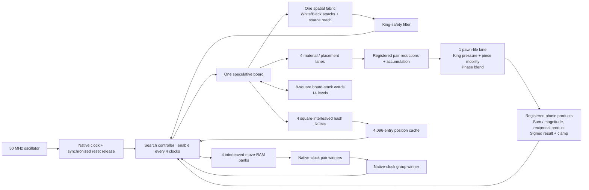

# Parallel search engine and clock pipeline

The advancement stages are implemented in RTL and the Pi-hosted client.
Build qualification and measured clock/resource figures are recorded in
[build-results.txt](build-results.txt) and [VALIDATION.md](VALIDATION.md).
The original design proposal remains in [ENGINE_ROADMAP.md](history/ENGINE_ROADMAP.md).

## Datapath

The engine still searches one speculative position at a time. Parallelism is
inside repeated node operations, with memory bandwidth matched to the lanes.
There are four evaluation lanes and four move-queue banks; there is one spatial
fabric and one search controller.

Evaluation issues four adjacent squares per controller enable. Four ROM banks
provide matching Zobrist keys. Lane scores are registered, combined into pairs,
then accumulated. Sixteen groups plus pipeline drain replace the scalar
64-step pass. File summaries, bishop counts, phase, draw flags and signed
per-piece rounding retain their own exact update rules. Save/restore handles
all 64 squares in both scalar reference and production configurations.

Pawn-file arithmetic streams through raw-term, per-file weight/round and
accumulation registers. Two drain enables finish the pass. The phase blend
also separates its final arithmetic: weighted products, summed magnitude,
reciprocal product, then sign restoration and clamping. These boundaries add
four controller enables per evaluated node in total, while removing long
arithmetic chains from a single register-to-register path.

The final division preserves integer truncation exactly. Divide the unsigned
magnitude by eight with a bit slice, multiply its 21-bit result by 699051,
then take bits 40..21 to divide by three. Here 699051 is `ceil(2^21 / 3)`;
for every 21-bit input the reciprocal error is below one third, too small to
cross the next integer quotient. Restoring the original sign matches signed
division by 24, including negative values. The arithmetic test compares the
actual RTL helper against language integer division near both limits and
across the input range.

Move selection reads four RAM entries together. The native-clock pipeline has
RAM outputs, two pair winners and one group winner. Registered address/mask
tags keep partial groups aligned with their data. The existing four-clock
controller interval allows these stages to settle without adding a controller
wait per group. Ties keep the lower queue index; removal still replaces the
selected entry with the final live entry.

## Search scheduling and decision quality

Each new depth searches the previous completed iteration's best root move
first. The first candidate establishes an exact value with a full window.
Subsequent candidates use a narrow alpha/alpha+1 window. A candidate that can
improve the best value is re-applied from the factual board and searched with
a full window. A losing scout returns an upper bound. Full-window reference
search remains available through the `ROOT_PVS` generic.

The complete legal root set is still published. Every candidate has its own
bound kind and completed depth; the chosen move must be exact. Root values
from different candidates now share one positional scoring convention.
Spatial, habit and random root bonuses do not get added on top of a searched
value. Spatial mode retains its original preference calculation.

Both colors use the same engine. A completed iteration owns a results bank,
selected move, score, static root terms and captured continuation. A timeout
discards an unfinished iteration and retains that completed set. The browser
still compares the entire hardware legal set with independent chess rules,
verifies the continuation, checks the selected explanation, commits with a
position generation and reads the board back.

The positional evaluator retains material, middlegame/endgame placement,
pawn structure, bishop pairs, rook files and shelter. It adds:

- King-zone attack coverage, weighted toward positions with more material.
- Weighted per-piece reach excluding friendly occupied destinations for
  knights, bishops, rooks and queens. This is pseudo-legal mobility and can
  include moves by pinned pieces. Search still checks every played move's king
  safety independently.
- Swap-off analysis for ambiguous defended captures by a more valuable piece.
  It follows least-valued attackers, including newly exposed slider rays,
  en passant and promotions. Defended king recaptures are rejected. Pinned
  non-king attackers are conservatively included, and the exchange chain is
  bounded. Its result changes ordering only; it never removes a move.

Policy indices 43 and 44 control king-pressure and mobility weights, 0..32.
Zero mobility weight skips its per-piece scan. The recurrent field remains
available as its own mode and as a completed snapshot in the console.

Normal depth can be 2 through 8, with up to four capture extensions and an
extra check-evasion level. Fourteen stack levels, cache remaining-stack bits,
policy validation and browser capabilities were advanced together. Requested
depth is distinct from completed depth and deepest visited tactical ply.

## Frequency and timing contract

The DE0-CV port uses its native **50 MHz** board oscillator without a PLL.
SPI, the engine and RAM share that clock. The existing `PAWN_LANES=1` option
removes the second pawn-file arithmetic lane to reduce logic use.
The SPI bridge passes `CLOCK_HZ` to the engine so watchdogs, think budgets,
48-bit cycle counters and browser timing use the same frequency. The engine
and search-memory arrays infer Cyclone V M10K blocks. The original DE10-Lite
clock and fit measurements do not apply to this device; the port's measured
results are in [build-results.txt](build-results.txt).

The search controller retains its four-clock enable. The queue-comparison
pipeline, exchange analyzer, SPI and RAM outputs use native clocks and receive
single-cycle timing checks. Only explicitly identified common-enable register
banks receive the paired four-cycle setup/three-cycle hold exceptions.

Timing reports first exposed an unintended persistent scratch variable in the
mobility calculation. Initializing that variable removed its native-clock
feedback path. The next limiting paths ran from move decoding into RAM-write
and exchange-start pulse registers. Decoding now ends in registers updated on
the controller enable; a short phase decode creates the native strobe. The
write/start edge remains the clock immediately after that enable. This moves
the long decode to the controller timing domain while keeping native strobes
and RAM inputs subject to their real single-cycle requirements.

The native PRNG feeds a short predictor register on each controller enable.
It advances the LFSR by the known four-clock interval so the next enable sees
the same sample as the original native generator. Reseeding adjusts that
prediction for the seed-write edge. Long field/root arithmetic now reads the
enabled sample. The root field byte is captured during the existing settle
step before its weight is applied.

The exchange analyzer also separates initial board copy from capture setup,
piece reads from attack geometry, and gain-array reads from swap/fold writes.
These stages remain native-clock operations with single-cycle constraints.
Their extra clocks are included in the measured exchange-wait count.

Decision time, time budgets and phase counters are 48 bits. At 100 MHz a
32-bit cycle counter would wrap after about 43 seconds; the wider counters
cover the full configurable think budget. Status cycles and telemetry are
captured coherently before their bytes are transferred.

`tools/build_fpga.ps1` builds an isolated source snapshot. A candidate is copied
to `output_files` only after all-corner setup/hold/recovery/removal checks,
external timing coverage checks and an input-hash check pass. Failed candidates
remain under `.cache`; the programming images in `output_files` remain intact.
The stage path is written to `.cache/fpga-last-build.txt`. Timing exports list
the top twenty setup paths at each corner, plus separate native-source and
native-endpoint reports so a repeated controller path cannot obscure them.

A passing routed timing analysis is distinct from physical-board acceptance.
The validation record states which measurements have actually been performed.

## Console and protocol

Protocol 5 uses the `SCF2` status signature so an old page cannot interpret a
bound as an exact score. Load the matching FPGA image and Pi service together.
The updated browser also supports the older protocol 3/4 layouts within their
advertised depth limits.

The console reports clock frequency, evaluation lanes, requested/completed
depth, maximum visited ply, cache answers, root re-searches and exchange calls.
Seven mutually exclusive phase counters reconcile with snapshot decision
cycles. The phase bar and legend show those measured values. Candidate bounds
are labeled, and the captured principal-variation prefix is replayed through
the browser's legal moves before commit. Cache cutoffs can shorten that prefix;
it is not presented as a complete eight-ply line when fewer moves were captured.

The chosen move's search value describes the searched outcome. The displayed
king/mobility terms describe its immediate root position, not a decomposition
of every later position in the minimax tree. The field heatmap remains the
last completed snapshot, not a cycle-by-cycle animation.

See [ENGINE_PROTOCOL.md](ENGINE_PROTOCOL.md) for byte layouts and
[advancement-results.json](advancement-results.json) for controlled scalar,
lane, PVS and queue comparisons. These comparisons establish correctness and
efficiency for their fixtures; they do not establish an Elo gain.
