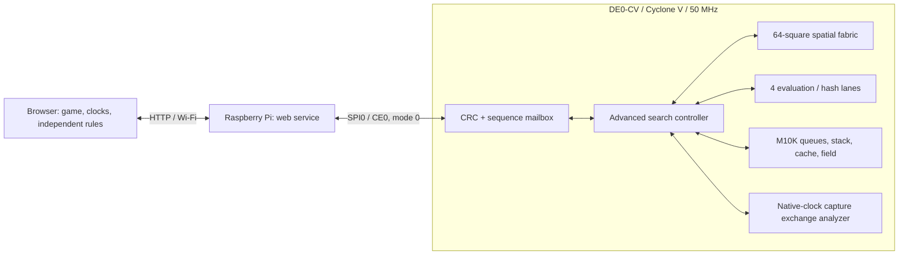

# DE0-CV system architecture

The browser manages the game, the Raspberry Pi bridges HTTP to SPI, and the
FPGA chooses every engine move. No software engine is used by the service.

The board wrapper `rtl/de0cv_chess.vhd` uses CLOCK_50 directly. No PLL or
second engine/SPI clock domain is required. Reset and KEY0
assert reset asynchronously; a four-stage register synchronizes release.
KEY1 and the SPI input signals have synchronizers. MISO releases when chip
select is high; IRQ is an optional open-drain ready indicator.

`spi_target.vhd` implements the reference's auto-increment register frames.
`chess_spi_bridge.vhd` validates complete request frames and CRCs, caches the
latest response for retry, copies commands to the engine, and snapshots reply
bytes into synchronous M10K RAM. It forwards the actual clock to the engine.
The independent search continues while the Pi polls status and telemetry.

The engine searches one speculative board at a time. Alpha-beta, root PVS,
cache hints, capture ordering, killer/history moves and quiescence limit work.
Four evaluation/hash lanes and four move banks accelerate repeated node work;
eight-square stack words restore boards. A single pawn-file lane contributes the
position terms. RAM, exchange analysis and SPI run on native clocks while
the controller advances every four clocks. The SDC carries the current
engine's complete enabled-register constraints; native paths stay single cycle.

A browser turn uploads the factual board, policy, seed and recent moves, then
starts the FPGA. Search publishes complete iterations into separate result
banks, retaining the last complete iteration when a deadline expires. The
browser compares the full hardware legal set against its independent rules,
validates candidate bounds and the continuation, commits the selected move
with a matching position generation, and verifies the resulting board.

Pi runtime assets are local files in `web/`; the project has no embedded Pico
firmware or external reference-directory dependencies. See the
[SPI mailbox](SPI_PROTOCOL.md) and [engine payloads](ENGINE_PROTOCOL.md).
