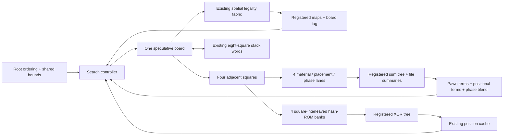

# Engine advancement: stronger search and a parallel pipeline

This is the original architecture proposal, based on release `7b75290`.
Its stages are now implemented: phase profiling, root ordering/PVS, four
evaluation and hash lanes, positional terms, capture exchange ordering,
registered control strobes, a PLL clock and eight-ply capability. Four banked
move queues were added as well. The prospective wording below records the
original design rationale and acceptance criteria.

For the current implementation, read [ADVANCED_ENGINE.md](../ADVANCED_ENGINE.md).
[VALIDATION.md](../VALIDATION.md) separates measured results from remaining
physical-board checks. Playing-strength gains still require equal-time games;
the implemented mechanisms alone do not establish a rating.

The objective is better decisions within the same think time. Three separate
improvements contribute: visit fewer unnecessary positions, evaluate each
position in fewer clocks, and shorten register-to-register paths enough to
raise the clock. More nodes per second alone is not the strength criterion.

## Starting point

| Item | Released design |
| --- | --- |
| Search | One shared speculative board and controller; iterative deepening, alpha-beta, ordered moves, cache, capture extensions |
| Spatial fabric | One instance; concurrent White/Black attack maps and selected-source reach |
| Repeated datapath work | Eight-square restore, parallel source mask, two pawn-file arithmetic lanes |
| Evaluation and hashing | One square per controller enable; 64 issue steps per node |
| Root scheduling | Ascending enumeration; each legal root candidate starts a separate full-window search |
| Clock | 50 MHz; controller enable every four clocks, or 12.5 million enables/second |
| Timing estimate | Released routed report: 55.84 MHz worst-corner Fmax; higher-clock operation has not been qualified |
| Resources | 30,949 / 49,760 logic elements; 125 / 182 M9K blocks; 45 / 288 nine-bit DSP elements |
| Depth limits | Six normal plies, four capture-extension plies, twelve stack levels |

The previous 2.336x throughput measurement covers two deterministic fixtures.
It establishes neither a whole-game speedup nor a strength rating. The next
comparison should include quiet middlegames, tactical positions, check
evasions, promotions and sparse endings.

## Recommended sequence

| Stage | Concrete change | Expected benefit | Evidence before adoption |
| --- | --- | --- | --- |
| 0 | Short phase profile and detailed routed timing paths | Identify the current recurring costs and clock limiter | Cycle shares and top paths from the same source revision |
| 1 | Previous-iteration root ordering, consistent search scores, shared root alpha; then principal-variation search | Spend fewer nodes disproving weak moves and finish useful depth earlier | Reference search agrees on the best value; candidate bounds and deadlines remain correct |
| 2 | Four evaluation lanes, four hash-ROM banks, registered reductions | Reduce the 64-square evaluation pass to 16 groups plus pipeline overhead | Same evaluation/hash at fixed settings; lower cycles per position; acceptable fit |
| 3 | Add measured king-pressure and mobility terms; improve capture ordering | Improve positional judgment and tactical efficiency | Tactical/positional cases and paired games at equal think time |
| 4 | Pipeline actual limiting paths, then introduce a PLL clock | Increase useful work per second, including the option of faster internal issue | Fully constrained timing at all corners and working board/UART behavior |
| 5 | Expand normal depth to seven/eight when useful | Spend the throughput gain on longer continuations | Stack, cache metadata, timeout and host capability checks |

Stages 1 and 2 are the first implementation pair. Stage 1 improves search
scheduling; stage 2 improves the hardware doing each search. Revisit phase
shares after each, because the next bottleneck can change.

## 0. Measure enough to choose the next block

Add grouped cycle counters for root preparation, node evaluation/hash,
move generation/legality, ordered-queue selection, board restore and cache
handling. Count native clocks, including waits, with mutually exclusive groups
whose sum reconciles with decision time. Keep HTTP/UART delivery time separate.
Capture a snapshot for a coherent telemetry reply.

Export the top setup paths with startpoint, endpoint, corner, clock relationship,
logic/routing delay and applicable multicycle exception. Include critical
CE-to-CE, CE-to-native and native-to-native paths. The existing summary reports
slack but does not identify which block currently limits frequency.

This is a short baseline capture using existing representative fixtures, not
a prerequisite for a large new benchmark suite.

## 1. Make the search budget more effective

First retain the completed iteration's root moves and search its best move
first on the next iteration. Preserve a stable candidate identifier separate
from search order. Initially keep full windows to isolate the ordering change.
The existing cache, capture, killer and quiet-history ordering inside the tree
remains useful; those mechanisms already exist.

Next make the scoring contract explicit. Current root ranking adds spatial,
activity, habit and noise contributions to the searched score difference.
These contributions differ between root moves, so a pruning bound expressed
in the final ranking cannot simply be passed into the child search unchanged.

The preferred search-mode policy is to rank by the searched position value,
using root preferences for ordering and exact-score ties. Spatial mode keeps
its existing preference scoring. This is a deliberate playing-policy change
and needs comparison against the legacy policy. Cache scores remain position
values, independent of root preferences. Fix any per-move random preference
for the decision so changing traversal order or clock rate does not change it.

Then share the best established root value as alpha between candidates.
Search the first candidate with a full window. Add principal-variation search
after shared-alpha search is correct: try later candidates with a narrow window
and re-search a candidate that may improve the principal variation. Keep a
full-window fallback. Aspiration windows are a later refinement. Stockfish's
[search implementation](https://github.com/official-stockfish/Stockfish/blob/master/src/search.cpp)
is a primary reference for previous-iteration PV ordering, bound handling and
window re-search; its tuning constants are not design targets for this engine.

### Complete legal moves, honest scores

Enumerating the complete legal root set and calculating exact scores for every
losing candidate are separate jobs. Continue returning every legal move for
the browser's independent verification. Extend the candidate protocol with
score kind (exact, upper bound, lower bound) and completed depth. Show bounds
as bounds in the console. A list of upper bounds cannot be presented as an
exact ranking of the runners-up.

Only publish an iteration once every root candidate has a valid result or
bound sufficient to establish its winner. The winner must have an exact score
at that depth; re-search when necessary. Keep the previous complete bank on
timeout, including its move, score kinds and explanations. Preserve the
generation-guarded commit and board readback. Version/capability negotiation
must stop an older client from interpreting the new records as protocol 4.

An optional analysis mode can re-search runners-up for exact displayed scores.
Ordinary play should spend that time on the next useful search iteration.

## 2. Four-lane evaluation with matching memory bandwidth

Process four adjacent squares together. Each lane computes material,
middlegame/endgame placement, phase and per-piece summaries. Group alignment
keeps the four files distinct. Sum lane contributions through a balanced,
registered tree; retain enough width and preserve existing per-piece weighting
and signed rounding before reduction. Combine bishop counts, draw-detection
flags and file extrema explicitly.

Bank the existing Zobrist constants by square modulo four. Four arithmetic
lanes need four key reads; a single ROM read port would serialize the work.
Keep the same logical constants and verify actual M9K packing. Packed stack
writes remain eight squares per word and can proceed at their existing group
boundaries independently of evaluation results.

Start with four squares per existing controller enable: 16 issue groups plus
pipeline fill/drain, compared with 64 scalar issue steps. That is a target for
this pass, not a promised fourfold whole-engine gain. Preserve a one-lane
reference configuration.

Use a request/valid/completion interface for the evaluator. After the first
implementation is stable, the datapath can issue on native clocks while the
controller waits for completion. Tag results with a search/board epoch so a
stop, reset, board restore or new command cannot consume stale pipeline data.

Incremental hashing and raw material/placement accumulators are a later option
if this pass remains expensive. They need correct updates for captures,
castling, en passant, promotions and metadata, plus exact restore state. Do not
incrementally accumulate rounded final scores or assume king shelter and pawn
structure are local to the moved square.

## 3. Improve positional judgment

Keep existing phase blending, pawn structure, bishop pairs, rook-file terms
and pawn shelter. Add new terms one at a time:

1. King-zone pressure from attacked squares near the king, weighted by game
   phase and shelter. Existing attack maps provide coverage; they do not
   provide attacker counts or a proof that every apparent attack is legal.
2. Piece mobility from per-piece reach and friendly occupancy, with appropriate
   treatment of pawn control and pinned pieces. Counting the union attack map
   is not a per-piece mobility evaluation. Account for the cost of producing
   any additional reach maps before adding lanes for them.
3. Static exchange evaluation for capture ordering, including x-ray attackers
   and special captures. First use it to order moves; pruning based on it is
   a separate experiment so an approximate estimate cannot silently discard
   the critical tactic.

Make these terms visible as measured score components. Tune on a separate set
from the acceptance positions and use paired games with colors reversed at
equal FPGA think time. Report tactical solves and positional regressions
separately from wins/draws/losses. No Elo or strength multiplier follows from
the datapath speedup alone.

Retain full check evasions and terminal/draw handling. Late-move reductions,
null-move pruning and aggressive quiescence pruning are later experiments;
their tactical and endgame failure modes need individual evaluation.

## 4. Pipeline the limiting paths, then raise the clock

The 55.84 MHz estimate belongs to the released layout. A reorganized datapath
can exceed it if the longest constrained paths become shorter. Candidate
blocks include priority selection, score/evaluation arithmetic, board muxes,
attack-map reductions and host decoding; the detailed timing report decides
which one to change first.

Register intermediate reductions and use balanced mux/comparator trees. When
registering spatial maps, associate them with the exact speculative board and
source that produced them, and wait for validity before checking legality.
Duplicating a critical source register may reduce fanout; duplicating an
entire engine retains its internal critical paths and consumes much more RAM.

If queue selection dominates after the other changes, split its entries across
four banks, compare four records at once and register the winning pair/tree.
Handle invalid final lanes, read latency, removal by swapping the last entry,
and the reference tie rule. Four comparators need four actual RAM reads.

The current four-cycle enable is part of the RAM schedule and timing contract.
Retain it for the initial lanes. Audit the SDC register collections when adding
native-clock stages: the existing broad `eval_*` and similar patterns must not
give four-cycle exceptions to registers that update every clock. Reduce the
controller divider only after replacing implicit waits with explicit pipeline
validity and updating all affected setup/hold constraints.

Use the MAX 10 PLL to synthesize the internal clock from the 50 MHz board
reference; see the [MAX 10 PLL guide](https://docs.altera.com/r/docs/683047/21.1/max-10-clocking-and-pll-user-guide/plls-overview?contentId=aIxzdj341CSV0OyPBiRSWA).
For the first clock change, one shared internal clock for the engine and UART
avoids introducing a new inter-domain command crossing. Hold logic in reset
until the PLL is locked, synchronize reset release, derive generated clocks,
and update UART divisors, think-budget/watchdog calculations and reported
counter frequency. The browser must read the frequency rather than assume
50 million cycles/second.

Try 55 MHz first. After path restructuring, explore 62.5/75 MHz and consider
100 MHz only if the routed paths support it. These are experiment targets,
not promised operating points. Compare effective positions per second:
extra pipeline waits or a larger enable divider can cancel a frequency gain.
Require covered setup/hold/recovery/removal timing at every available corner
and a physical-board UART/search check before publishing a faster image.

Use 80% logic and 85% M9K occupancy as provisional review targets, leaving
placement/routing margin. These are planning budgets, not device limits or
guarantees. Prefer selective lanes over multiple complete search engines on
this device. Persistent scored-cache reuse is also deferred until policy,
root-relative score orientation, mate distance and repetition context have
an explicit validity scheme; removing the epoch check alone is insufficient.

## 5. Spend the gain on useful depth

Once more positions complete within the budget, lift the six-ply normal limit
to seven/eight as a separate change. Update `MAX_SEARCH_DEPTH`, stack levels,
per-level tables, cache depth/remaining-stack fields, policy validation,
browser choices and advertised capabilities together. Budget for capture
extensions and the extra check-evasion level; changing only the UI limit does
not add search capacity.

Maintain iterative deepening and completion-based publication. A requested
eight plies that repeatedly times out at the same completed depth is not a
strength improvement. Report requested depth, completed normal depth and
maximum tactical depth separately.

## Acceptance and console

For a datapath-only change, compare fixed-depth values, hashes and legal sets
against the one-lane/reference design. For search ordering/pruning, compare the
exact best value and verify reported bounds against a full-window reference;
node counts are expected to change. Resolve equally scored moves with a
declared tie rule. For evaluation changes, use equal-time chess comparisons.
Run focused checks for the changed stage and the existing required regression
checks; broaden them when results expose a concern.

The console can expose the result without inventing activity: time spent in
each measured phase, completed depth, principal variation, exact/bound labels,
cache hits that supplied a cutoff versus ordering hints, and reported clock
frequency. Pipeline occupancy or lane utilization requires real valid/stall
counters. Keep the field heatmap identified as the last completed snapshot.

For each adopted stage, record source revision, physical clock, controller
enable, fitted resources, all-corner timing, cycles/position, completed depth
under the same budget and chess results. The next release should be judged by
that combination rather than frequency or node count in isolation.
